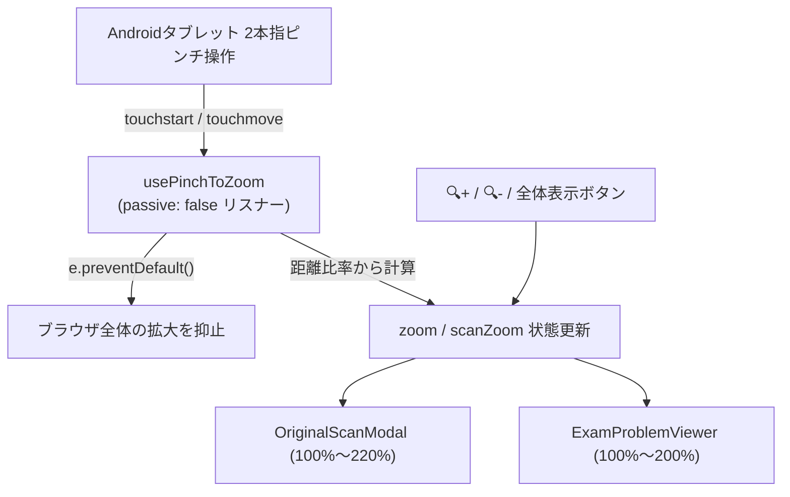

# 原本表示ピンチイン・アウト（Pinch to Zoom）実装計画

> **For agentic workers:** REQUIRED SUB-SKILL: Use superpowers:subagent-driven-development (recommended) or superpowers:executing-plans to implement this plan task-by-task. Steps use checkbox (`- [ ]`) syntax for tracking.

**Goal:** Androidタブレットなどのタッチ端末で問題・解答の原本を表示中、原本領域での2本指ピンチイン・アウトにより画面全体の拡大を防ぎつつ原本のみを拡大縮小できるようにする。

**Architecture:** 2本指のタッチイベントを検知してブラウザ全体のviewportズームを抑止（`preventDefault`）し、指の距離比率に応じてズーム倍率を更新するカスタムフック `usePinchToZoom` を新設。これを原本表示を担う `ExamProblemViewer` と `OriginalScanModal` のコンテナ要素に接続し、既存の拡大縮小ボタンとも完全に同期させる。

**Architecture Diagram:**



**Tech Stack:** React 18, TypeScript, Vitest / React Testing Library

**Spec:** [2026-11-13-pinch-to-zoom-original-design.md](file:///C:/Users/sho/.gemini/antigravity/worktrees/saka-guchi.github.io/pinch_to_zoom_exam_original/junior-vet-exam-chart/docs/superpowers/specs/2026-11-13-pinch-to-zoom-original-design.md)

## Global Constraints

- 言語・UI・コメントはすべて日本語で記述する。
- ブラウザネイティブの `alert()` / `confirm()` は使用しない。
- 1本指による通常スクロール操作（パン）を損なわない（`touch-action: pan-x pan-y` を付与し、1本指時は `preventDefault` しない）。
- 既存のボタン操作（🔍+, 🔍-, 全体表示）およびテストケースを一切壊さない。

## Review Focus

- 2本指タッチ移動時に `e.preventDefault()` が呼ばれ、ブラウザ標準ズームが抑止されること。
- 1本指タッチ移動時は `e.preventDefault()` が呼ばれず、標準スクロールが阻害されないこと。
- 指の距離が縮まったときに縮小、広がったときに拡大し、`minZoom` と `maxZoom` の範囲外にはみ出さないこと。
- ピンチ終了（`touchend`, `touchcancel`）後に次のタッチ操作が正常に行えること。
- 既存のズームボタン操作とピンチ操作のズーム状態が完全に同期していること。

---

### Task 1: `usePinchToZoom` カスタムフックの実装と単体テスト

**Files:**
- Create: `junior-vet-exam-chart/src/utils/use-pinch-to-zoom.ts`
- Test: `junior-vet-exam-chart/src/utils/use-pinch-to-zoom.test.tsx`

**Interfaces:**
- Produces: `usePinchToZoom<T extends HTMLElement = HTMLDivElement>(options: UsePinchToZoomOptions): { containerRef: React.RefObject<T | null> }`

- [ ] **Step 1: Write the failing test**

```typescript
// junior-vet-exam-chart/src/utils/use-pinch-to-zoom.test.ts
import { describe, it, expect, vi } from 'vitest';
import { renderHook, act } from '@testing-library/react';
import { usePinchToZoom } from './use-pinch-to-zoom';

describe('usePinchToZoom', () => {
  it('registers touch listeners and updates zoom on pinch', () => {
    const onZoomChange = vi.fn();
    const { result } = renderHook(() =>
      usePinchToZoom({ zoom: 100, onZoomChange, minZoom: 100, maxZoom: 200 })
    );
    const element = document.createElement('div');
    // @ts-expect-error assigning to current for test
    result.current.containerRef.current = element;

    // Simulate touchstart with 2 touches (distance = 100)
    // touchmove with distance = 150 (ratio = 1.5, expected zoom = 150)
  });
});
```

- [ ] **Step 2: Run test to verify it fails**

Run: `npm --prefix junior-vet-exam-chart test -- src/utils/use-pinch-to-zoom.test.ts`
Expected: FAIL with module not found or undefined

- [ ] **Step 3: Implement `usePinchToZoom` in `junior-vet-exam-chart/src/utils/use-pinch-to-zoom.ts`**

非パッシブ（`{ passive: false }`）イベントリスナーとして `touchstart`, `touchmove`, `touchend`, `touchcancel` を `containerRef.current` に登録し、2本指タッチ時の距離比率を元にズーム倍率を算出し `onZoomChange` を呼ぶ。2本指操作時は `e.cancelable && e.preventDefault()` を呼ぶ。

- [ ] **Step 4: Run test to verify it passes**

Run: `npm --prefix junior-vet-exam-chart test -- src/utils/use-pinch-to-zoom.test.ts`
Expected: PASS

- [ ] **Step 5: Commit**

```bash
git add junior-vet-exam-chart/src/utils/use-pinch-to-zoom.ts junior-vet-exam-chart/src/utils/use-pinch-to-zoom.test.ts
git commit -m "feat: add usePinchToZoom hook for touch pinch gestures"
```

---

### Task 2: `OriginalScanModal.tsx` へのピンチズーム統合

**Files:**
- Modify: `junior-vet-exam-chart/src/components/OriginalScanModal.tsx`
- Test: `junior-vet-exam-chart/src/components/OriginalScanModal.test.tsx` (新規または既存拡張)

**Interfaces:**
- Consumes: `usePinchToZoom` from `../utils/use-pinch-to-zoom`

- [ ] **Step 1: Write test for OriginalScanModal pinch integration**

`OriginalScanModal` の原本コンテナ要素にタッチイベントを発火し、ズーム状態がピンチ操作で変化することを検証するテストを追加。

- [ ] **Step 2: Run test to verify it fails**

Run: `npm --prefix junior-vet-exam-chart test -- src/components/OriginalScanModal.test.tsx`
Expected: FAIL

- [ ] **Step 3: Connect `usePinchToZoom` in `OriginalScanModal.tsx`**

原本画像コンテナ要素に `containerRef` を付与し、`touchAction: 'pan-x pan-y'` を設定。`minZoom: 100, maxZoom: 220` でフックを初期化。

- [ ] **Step 4: Run test to verify it passes**

Run: `npm --prefix junior-vet-exam-chart test -- src/components/OriginalScanModal.test.tsx`
Expected: PASS

- [ ] **Step 5: Commit**

```bash
git add junior-vet-exam-chart/src/components/OriginalScanModal.tsx junior-vet-exam-chart/src/components/OriginalScanModal.test.tsx
git commit -m "feat: integrate pinch-to-zoom into OriginalScanModal"
```

---

### Task 3: `ExamProblemViewer.tsx` へのピンチズーム統合

**Files:**
- Modify: `junior-vet-exam-chart/src/components/final-challenge/ExamProblemViewer.tsx`
- Test: `junior-vet-exam-chart/src/components/final-challenge/ExamProblemViewer.test.tsx` (新規または既存拡張)

**Interfaces:**
- Consumes: `usePinchToZoom` from `../../utils/use-pinch-to-zoom`

- [ ] **Step 1: Write test for ExamProblemViewer pinch integration**

単ページ表示および見開き表示コンテナでのピンチタッチイベントにより `onScanZoomChange` が呼ばれることをテスト。

- [ ] **Step 2: Run test to verify it fails**

Run: `npm --prefix junior-vet-exam-chart test -- src/components/final-challenge/ExamProblemViewer.test.tsx`
Expected: FAIL

- [ ] **Step 3: Connect `usePinchToZoom` in `ExamProblemViewer.tsx`**

原本画像エリア（単ページおよび見開きコンテナ）に `containerRef` を付与し、`touchAction: 'pan-x pan-y'` を設定。`minZoom: 100, maxZoom: 200` でフックを接続。

- [ ] **Step 4: Run test to verify it passes**

Run: `npm --prefix junior-vet-exam-chart test -- src/components/final-challenge/ExamProblemViewer.test.tsx`
Expected: PASS

- [ ] **Step 5: Commit**

```bash
git add junior-vet-exam-chart/src/components/final-challenge/ExamProblemViewer.tsx junior-vet-exam-chart/src/components/final-challenge/ExamProblemViewer.test.tsx
git commit -m "feat: integrate pinch-to-zoom into ExamProblemViewer"
```

---

### Task 4: 全体リグレッションテストと品質検証

**Files:**
- Verification: 全テストスイート実行

- [ ] **Step 1: Run all existing tests and build**

Run: `npm --prefix junior-vet-exam-chart test`
Run: `npm --prefix junior-vet-exam-chart run build`
Expected: すべてのテストとビルドが成功（PASS）

- [ ] **Step 2: Commit documentation & lessons learned if applicable**

```bash
git add junior-vet-exam-chart/docs/
git commit -m "docs: add pinch-to-zoom design and implementation plan"
```
